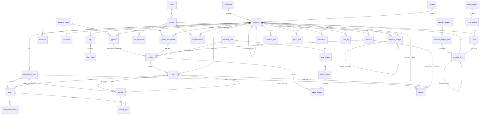

# 02 — Data model (`hr_app`, schema `hr`)

| | |
|---|---|
| Status | Approved baseline (v2, 3NF, 40 tables) |
| Owner | Spring Boot / Flyway |
| Rule | Every change: new Flyway migration **and** an update of this file in the same change (R-DB-1) |

The case file and the case roles are in `03-case-file.md`. How the parts talk to each other is in `01-overview.md`.

**Change log**

| Date | Change |
|---|---|
| 2026-10-15 | Baseline v2: 39 tables, consolidated from v1 (66) |
| 2026-10-15 | F01 decisions applied: **+`onboarding_draft`** (Q13, now 40 tables); `document.employee_id` nullable + doc_type `POLICY`; `checklist_template_item.policy_document_id` (Q7); `employee.stage` no longer has `DRAFT` and the draft/case_id CHECK is removed |
| 2026-10-21 | **F01 onboarding gap fixes (`V18__onboarding_gaps.sql`), seed data only — no schema change:** `checklist_template_item.item_kind` set where unambiguous (IT_ADMIN items in EQUIPMENT_ISSUED → EQUIPMENT, in ACCOUNTS_INSTALLATIONS → ACCOUNT; EMPLOYEE-owned items by name → POLICY_ACK / PROFILE / EQUIPMENT_CONFIRM). Only GENERIC rows are touched; instantiated `checklist_item` snapshots are not (ADM-04). Writes now made by existing columns: `checklist_item.asset_id` (A21/A22), `document` rows with `doc_type = 'POLICY_ACK'` (A27). See F01 spec §12 D-24. |
| 2026-10-21 | **F02 probation (`V17__probation_review.sql`):** `review_answer` created (documented in §2.6 but never applied by V1–V16), with the standard audit columns (R-DB-2) in addition to the DDL below; indexes `ix_review_contract`/`ix_review_reviewer` (FRD-02 v1.2 §5, missing from V13); view `v_contract` (§2.9, never applied before — F01 computed ONB-01 in Java). Seed change: the PROBATION form's placeholder YES_NO question replaced by the FRD's three 1–5 questions plus a required TEXT "Summary" question (the probation summary is stored in `review_answer.text_answer`; `review` has no summary column). No column added. |
| 2026-10-19 | **`job_title.grade` + `job_title.department_id` added** (`V15__job_title_grade_department.sql`, FRD-08 S1, user decision 2026-10-19 reversing FRD-08 spec §12 D-01). Adopts FRD-08 v1.2 Appendix A #8's own suggested fix so the Job titles table and the "Add job title" pop-up match the wireframe (Grade, Department). Both nullable for pre-existing rows; the API requires both on create. `grade` reuses `employee.grade`'s CHECK list; `department_id` is `ON DELETE RESTRICT`, so a department used by a job title cannot be removed (ADM-03). These are attributes of the job title itself; they do not replace or derive `employee.department_id`/`employee.grade`, so 3NF holds. |
| 2026-10-17 | **Applied early, out of feature order (user-approved):** `appraisal_form`/`form_section`/`form_question` (F09/FRD-08 Gate 1, `V11__create_appraisal_form_tables.sql`) and `client`/`project`/`project_assignment`/`client_feedback`/`employee_exit`/`development_plan`/`appraisal_round`/`appraisal`/`pip`/`review`/`checkin` + their 6 report views (F09/FRD-08 Gate 2 reports, `V13__create_report_tables_and_views.sql`) were already fully designed here but had never actually been created by `V1__init.sql` — a design/applied-schema gap, not new design. They were applied now, ahead of F04 (Projects)/F06 (Appraisal)/F07 (PIP)/F08 (Offboarding) having their own specs or gates, purely so FRD-08's 8 reports could read real data instead of placeholders. The DDL is unchanged from what was already documented below — nothing here was designed or altered for this purpose. When F04/F06/F07/F08 are later spec'd and reach their own Gate 1, these tables already exist; that gate adds whatever (if anything) those specs still need on top, rather than creating them from scratch. `goal`, `development_activity`, `checkin_goal` and `review_answer` remain undocumented-as-applied (not needed by any of the 6 report views) — still future work for their owning features. |
| 2026-10-17 | **Same gap, found again:** `manager_change` (§2, line ~356) was documented here and in FRD-01 v1.2 §5, both of which assumed it was "already in the baseline, migrated by F01's gate 1" — it was not; `V1__init.sql` never created it. Applied by `V14__create_manager_change_tables.sql` (F03/FRD-01 Wave 3, Gate 1), DDL unchanged from what was already documented below (+ standard audit columns, R-DB-2). **+1 table, user-approved 2026-10-17 (FRD-01 spec §12 D-W3):** `manager_change_task(change_id, engine_task_id)` — composite PK, no surrogate id — closes the gap both this doc (§6 item 14) and FRD-01 v1.2's own cross-check independently flagged: a single boolean can't represent "HR ticks individual tasks to move." Baseline is now 42 tables (40 + `appraisal_form`/`form_section`/`form_question` already counted in the 2026-10-17 entry above... — see §2's own table count note if one exists; this changelog does not re-total eagerly, line counts in §2 are the source of truth). |

## 2. Database schema (`hr_app`, schema `hr`): 40 tables

### Conventions

These apply to every table and are not repeated in the DDL below.

- **Primary key:** `id bigint generated always as identity`.
- **Audit columns:** `created_at`, `created_by`, `updated_at`, `updated_by`, and `version` for optimistic locking.
- **Enums:** `varchar` + `CHECK`.
- **Dates:** business dates are `date`; moments are `timestamptz`.
- **Foreign keys:** `ON DELETE RESTRICT` unless noted, which gives ADM-03 ("in use cannot be removed") for free.
- **Validation:** rules that need "today" or a lookup in another table (for example age ≥ 16 or G-13 when the subject sits in the parent row) are enforced in Spring with the exact FRD messages.
- **G-09:** no salary, bank or ID-number columns.
- **Typed tables.** `review`, `goal`, `checkin` and `decision` are typed: a `*_type` column plus exactly one parent foreign key, enforced with `num_nonnulls(...) = 1` and a CHECK per type. In JPA they map to `SINGLE_TABLE` inheritance.

### 2.1 Organisation & people (5)

```sql
create table department (
  id bigint generated always as identity primary key,
  name varchar(100) not null unique
);

create table job_title (                                   -- grade/department = the job title's own defaults; employee keeps its own department_id/grade
  id bigint generated always as identity primary key,
  name varchar(100) not null unique,
  grade varchar(10) check (grade in ('JUNIOR','MEDIOR','SENIOR','SENIOR_I','SENIOR_II')),  -- V15; NULL only on pre-V15 rows
  department_id bigint references department                -- V15; NULL only on pre-V15 rows
);

create table employee (
  id bigint generated always as identity primary key,
  employee_code varchar(10) not null unique,               -- E-0031 = CaseFabric case id
  case_id varchar(64) unique,                              -- NULL only between commit and engine case start (drafts live in onboarding_draft)
  first_name varchar(100) not null,
  last_name varchar(100) not null,
  private_email varchar(254) not null unique,              -- ONB-09
  work_email varchar(254) unique,
  mobile_phone varchar(30) not null,
  date_of_birth date not null,
  nationality varchar(60),
  street varchar(150) not null,
  postcode varchar(12) not null,
  city varchar(100) not null,
  emergency_name varchar(150),
  emergency_relationship varchar(60),
  emergency_phone varchar(30),
  job_title_id bigint not null references job_title,
  department_id bigint not null references department,
  grade varchar(10) not null check (grade in ('JUNIOR','MEDIOR','SENIOR','SENIOR_I','SENIOR_II')),   -- [ASSUMPTION] fixed list (was a table)
  manager_id bigint references employee,
  buddy_id bigint references employee,
  app_role varchar(10) not null check (app_role in ('HR','MANAGER','EMPLOYEE','IT_ADMIN')),
  idp_subject varchar(64) unique,                          -- Keycloak sub
  account_status varchar(12) not null default 'NOT_INVITED'
     check (account_status in ('NOT_INVITED','INVITED','ACTIVE','DISABLED')),
  first_login_at timestamptz,
  stage varchar(12) not null default 'ONBOARDING'
     check (stage in ('ONBOARDING','ACTIVE','PIP','OFFBOARDING','ARCHIVED')),   -- cache of engine state
  stage_since date,
  archived_at timestamptz,                                 -- G-10
  check (manager_id is null or manager_id <> id),
  check (buddy_id is null or buddy_id <> id)
);
create index ix_employee_manager on employee(manager_id);

create table contract (                                    -- one row per period; renew/convert adds a row
  id bigint generated always as identity primary key,
  employee_id bigint not null references employee,
  contract_type varchar(10) not null check (contract_type in ('PERMANENT','FIXED_TERM')),
  start_date date not null,
  end_date date,
  hours_per_week smallint not null check (hours_per_week between 1 and 40),
  probation_months smallint not null check (probation_months in (0,1,2)),   -- probation end = start + months (computed in v_contract)
  is_current boolean not null default true,
  check ((contract_type = 'PERMANENT') = (end_date is null)),
  check (end_date is null or end_date > start_date)
);
create unique index ux_contract_current on contract(employee_id) where is_current;

create table document (
  id bigint generated always as identity primary key,
  employee_id bigint references employee,                  -- NULL for company documents (POLICY) and for uploads made before the employee exists
  doc_type varchar(30) not null check (doc_type in ('CONTRACT','POLICY','POLICY_ACK','RESIGNATION_LETTER','PIP_ATTACHMENT',
            'DISPUTE_ATTACHMENT','CLIENT_FEEDBACK_ATTACHMENT','FINAL_DOCUMENT','OTHER')),
  file_name varchar(255) not null,
  content_type varchar(100) not null,
  size_bytes bigint not null check (size_bytes > 0),
  storage_key varchar(500) not null unique,
  uploaded_by bigint not null references employee,
  uploaded_at timestamptz not null default now()
);
```

### 2.2 Settings (7)

```sql
create table checklist_template (
  id bigint generated always as identity primary key,
  name varchar(100) not null unique,
  kind varchar(12) not null check (kind in ('ONBOARDING','OFFBOARDING')),
  job_title_id bigint references job_title,
  copied_from_id bigint references checklist_template,
  archived_at timestamptz                                  -- ADM-04
);

create table checklist_template_item (
  id bigint generated always as identity primary key,
  template_id bigint not null references checklist_template on delete cascade,
  name varchar(150) not null,
  section varchar(30) not null check (section in ('DOCUMENTS_ADMIN','EQUIPMENT_ISSUED','ACCOUNTS_INSTALLATIONS','ORIENTATION',
            'RETURN_ASSETS','REMOVE_ACCESS','HR_HANDOVER','REASSIGN_TEAM')),
  owner_role varchar(10) not null check (owner_role in ('HR','IT_ADMIN','MANAGER','EMPLOYEE','SYSTEM')),
  item_kind varchar(20) not null default 'GENERIC'
     check (item_kind in ('GENERIC','POLICY_ACK','PROFILE','EQUIPMENT_CONFIRM','EQUIPMENT','ACCOUNT','EXIT_INTERVIEW','ASSIGNMENTS_END')),
  mandatory boolean not null default true,
  due_offset_days int not null,
  policy_document_id bigint references document,          -- F01 Q7: policy PDF shown in the policy pop-up (item_kind POLICY_ACK)
  sort_order int not null default 0,
  check (policy_document_id is null or item_kind = 'POLICY_ACK')
);

create table appraisal_form (                              -- was form + form_rating_label
  id bigint generated always as identity primary key,
  name varchar(100) not null unique,
  used_for varchar(12) not null check (used_for in ('STANDARD','LEADERSHIP','PROBATION','PROJECT')),   -- PROJECT = project review form (seeded)
  status varchar(10) not null default 'DRAFT' check (status in ('DRAFT','ACTIVE','ARCHIVED')),
  overall_score_method varchar(20) not null default 'WEIGHTED_AVERAGE' check (overall_score_method in ('WEIGHTED_AVERAGE','MANAGER_DECIDES')),
  label_1 varchar(60) not null default 'Poor',             -- 1–5 scale is fixed by the FRD: one column per score
  label_2 varchar(60) not null default 'Below expectations',
  label_3 varchar(60) not null default 'Meets expectations',
  label_4 varchar(60) not null default 'Exceeds expectations',
  label_5 varchar(60) not null default 'Outstanding'
);

create table form_section (                                -- was section + form_section_respondent
  id bigint generated always as identity primary key,
  form_id bigint not null references appraisal_form on delete cascade,
  name varchar(100) not null,
  by_self boolean not null default false,
  by_peer boolean not null default false,
  by_manager boolean not null default false,
  by_hr boolean not null default false,
  sort_order int not null default 0,
  check (by_self or by_peer or by_manager or by_hr)        -- now enforced by the DB
);

create table form_question (
  id bigint generated always as identity primary key,
  section_id bigint not null references form_section on delete cascade,
  text varchar(200) not null,
  description varchar(300),
  answer_type varchar(10) not null check (answer_type in ('SCALE_1_5','YES_NO','TEXT')),
  required boolean not null default true,                  -- texts like "Key achievements" / "Keep doing" are TEXT questions
  sort_order int not null default 0
);

create table email_template (                              -- was template + email_template_recipient
  id bigint generated always as identity primary key,
  code varchar(40) not null unique,                        -- 21 FRD templates
  name varchar(100) not null unique,
  trigger_description varchar(200) not null,
  subject varchar(200) not null,
  body text not null,
  cc varchar(1000),
  to_employee boolean not null default false,
  to_manager boolean not null default false,
  to_hr boolean not null default false,
  to_it_admin boolean not null default false,
  to_task_owner boolean not null default false,
  to_peer boolean not null default false,
  active boolean not null default true,
  check (to_employee or to_manager or to_hr or to_it_admin or to_task_owner or to_peer)
);

create table setting (                                     -- was timer_rule + task_type_setting
  code varchar(60) primary key,                            -- TIMER: BENCH_CHECK, PIP_CHECKIN, ... (17); TASK_DUE: engine task name, e.g. 'Approve PIP'
  category varchar(10) not null check (category in ('TIMER','TASK_DUE')),
  module varchar(30) not null,
  label varchar(100) not null,
  value_int int check (value_int >= 0),
  value_unit varchar(12) check (value_unit in ('DAYS','SECONDS','MINUTES','CHARACTERS')),
  value_text varchar(20) check (value_text in ('QUARTERLY','HALF_YEARLY','YEARLY')),   -- KPI_CYCLE only
  recipient_role varchar(15) check (recipient_role in ('MANAGER','HR','MANAGER_HR','EMPLOYEE','TASK_OWNER','IT_ADMIN','ALL_USERS','NEW_USER','USER')),
  can_disable boolean not null default false,
  enabled boolean not null default true,
  check (can_disable or enabled),
  check (category = 'TIMER' or (value_int is not null and value_unit = 'DAYS')),
  check (code <> 'PASSWORD_MIN_LENGTH' or value_int between 8 and 64),
  check ((code = 'KPI_CYCLE') = (value_text is not null))
);
-- The React route per task type moves to frontend code (it is UI config, not data).
```

### 2.3 Onboarding & assets (4)

```sql
create table onboarding_draft (                            -- F01 Q13: unvalidated step-1 form ("Save draft"); deleted on Save & continue
  id bigint generated always as identity primary key,
  first_name varchar(100) not null,                        -- the only fields checked on Save draft (shown in the Employees list)
  last_name varchar(100) not null,
  form jsonb not null,                                     -- raw step-1 form as typed; never read by business logic
  contract_document_id bigint references document
);

create table onboarding (                                  -- was onboarding + it_request; created on Save & continue
  id bigint generated always as identity primary key,
  employee_id bigint not null unique references employee,
  template_id bigint not null references checklist_template,
  id_checked boolean not null default false,
  contract_signed_received boolean not null default false,
  right_to_work_verified boolean not null default false,
  status varchar(12) not null default 'IN_PROGRESS' check (status in ('IN_PROGRESS','COMPLETED','CANCELLED')),
  completed_at timestamptz,
  completed_by bigint references employee,
  it_laptop_model varchar(60),
  it_keyboard_layout varchar(30),
  it_ready_by date,
  it_delivery_method varchar(20) check (it_delivery_method in ('OFFICE_DAY1','SHIP_HOME')),
  it_notes text,
  it_status varchar(12) not null default 'NOT_SENT' check (it_status in ('NOT_SENT','SENT','IN_PROGRESS','COMPLETED')),
  it_sent_at timestamptz,
  check (id_checked and contract_signed_received),         -- "Confirm that the ID was checked and the contract is signed."
  check ((status = 'COMPLETED') = (completed_at is not null)),
  check (it_status = 'NOT_SENT' or (it_laptop_model is not null and it_ready_by is not null and it_delivery_method is not null))
);
-- Accessories and accounts requested from IT become checklist_item rows (EQUIPMENT / ACCOUNT, owner IT_ADMIN) on "Send to IT".

create table asset (                                       -- history comes from audit_log (entity_type = 'ASSET')
  id bigint generated always as identity primary key,
  asset_number varchar(20) not null unique,
  asset_type varchar(20) not null check (asset_type in ('LAPTOP','MONITOR','PHONE','ACCESS_BADGE','DOCKING_STATION','HEADSET','KEYBOARD_MOUSE','OTHER')),
  model varchar(100) not null,
  serial_number varchar(60),
  status varchar(15) not null default 'IN_STORAGE' check (status in ('IN_STORAGE','ISSUED','RETURN_DUE','RETURNED','NOT_RETURNED')),
  employee_id bigint references employee,
  issued_on date,
  return_due_date date,
  returned_on date,
  return_condition varchar(10) check (return_condition in ('GOOD','DAMAGED')),
  check (status not in ('ISSUED','RETURN_DUE','NOT_RETURNED') or employee_id is not null),
  check (status <> 'RETURNED' or return_condition is not null)
);

create table checklist_item (                              -- onboarding + offboarding; also replaces account_access
  id bigint generated always as identity primary key,
  employee_id bigint not null references employee,
  phase varchar(12) not null check (phase in ('ONBOARDING','OFFBOARDING')),
  template_item_id bigint references checklist_template_item,   -- NULL = "+ Add item"
  name varchar(150) not null,                              -- snapshot of the template item (see §6)
  section varchar(30) not null,
  owner_role varchar(10) not null,
  item_kind varchar(20) not null default 'GENERIC',
  mandatory boolean not null,
  due_date date not null,
  status varchar(10) not null default 'OPEN' check (status in ('OPEN','DONE','CANCELLED')),
  done_at timestamptz,
  done_by bigint references employee,
  asset_id bigint references asset,                        -- EQUIPMENT items
  removes_item_id bigint references checklist_item,        -- offboarding "remove access" → the onboarding ACCOUNT item
  overdue_reminder_at timestamptz,                         -- G-05 (V7); null = not yet overdue or not yet reminded
  check ((status = 'DONE') = (done_at is not null and done_by is not null)),
  check (removes_item_id is null or phase = 'OFFBOARDING')
);
create index ix_checklist_open on checklist_item(employee_id, phase, owner_role) where status = 'OPEN';
```

### 2.4 Projects (6)

```sql
create table client (
  id bigint generated always as identity primary key,
  name varchar(150) not null unique,
  industry varchar(80),
  address varchar(250)
);

create table project (
  id bigint generated always as identity primary key,
  project_code varchar(10) not null unique,
  name varchar(150) not null,
  client_id bigint not null references client,
  project_manager_id bigint not null references employee,
  project_type varchar(20) not null check (project_type in ('FIXED_PRICE','TIME_MATERIAL','INTERNAL')),
  status varchar(10) not null check (status in ('PLANNED','ACTIVE','ON_HOLD','OVERDUE','COMPLETED','WITHDRAWN')),
  start_date date not null,
  end_date date,
  work_mode varchar(100),
  tech_stack varchar(250),
  description text,
  contract_reference varchar(60),
  withdrawal_date date,
  withdrawal_reason text,
  closed_at timestamptz,
  check (end_date is null or end_date > start_date),
  check ((status = 'WITHDRAWN') = (withdrawal_date is not null and withdrawal_reason is not null))
);

create table project_contact (                             -- replaces client_contact (avoids project.client_id ← contact transitive dependency)
  project_id bigint not null references project on delete cascade,
  kind varchar(10) not null check (kind in ('POC','SECONDARY')),
  name varchar(150) not null,
  role varchar(80),
  email varchar(254),
  phone varchar(30),
  primary key (project_id, kind),
  check (kind = 'SECONDARY' or email is not null)          -- POC e-mail required
);

create table project_assignment (
  id bigint generated always as identity primary key,
  project_id bigint not null references project,
  employee_id bigint not null references employee,
  role_on_project varchar(80) not null,
  allocation_pct smallint not null check (allocation_pct between 1 and 100),
  start_date date not null,
  end_date date,
  end_reason varchar(20) check (end_reason in ('PROJECT_COMPLETED','PROJECT_WITHDRAWN','ENDED_EARLY','EMPLOYEE_LEAVING')),
  check (end_date is null or end_date >= start_date),
  check (end_reason is null or end_date is not null)
);
create index ix_assignment_emp on project_assignment(employee_id, end_date);

create table client_feedback (                             -- was + client_feedback_target
  id bigint generated always as identity primary key,
  project_id bigint not null references project,
  applies_to varchar(10) not null check (applies_to in ('TEAM','PERSON')),
  employee_id bigint references employee,                  -- PERSON only; TEAM = everyone assigned on received_date (view)
  contact_name varchar(150) not null,
  contact_role varchar(80),
  received_date date not null,
  collected_via varchar(10) not null check (collected_via in ('CALL','EMAIL','MEETING','SURVEY')),
  rating smallint not null check (rating between 1 and 5),
  comments text not null,
  attachment_document_id bigint references document,
  recorded_by bigint not null references employee,
  check ((applies_to = 'PERSON') = (employee_id is not null))
);

create table manager_change (                              -- was manager_transfer + _task + project_manager_change + _member
  id bigint generated always as identity primary key,
  scope varchar(8) not null check (scope in ('LINE','PROJECT')),
  employee_id bigint references employee,                  -- LINE: who moves
  project_id bigint references project,                    -- PROJECT: whose PM changes
  parent_id bigint references manager_change,              -- LINE rows created by a PROJECT change (one per ticked member)
  from_manager_id bigint references employee,              -- snapshot at request time
  to_manager_id bigint not null references employee,
  effective_date date not null,
  reason text,
  move_open_tasks boolean not null default true,           -- [ASSUMPTION] all open tasks move (no per-task picking)
  status varchar(10) not null default 'SCHEDULED' check (status in ('SCHEDULED','APPLIED','CANCELLED')),
  applied_at timestamptz,
  requested_by bigint not null references employee,
  check (num_nonnulls(employee_id, project_id) = 1),
  check ((scope = 'LINE') = (employee_id is not null)),
  check (parent_id is null or scope = 'LINE'),
  check (scope = 'LINE' or reason is not null),
  check (from_manager_id is distinct from to_manager_id)
);

-- Added 2026-10-17, F03/FRD-01 Wave 3 (§6 item 14, resolved): per-task selection for a
-- manager transfer — one row per engine_task HR ticked to move. Composite PK, no surrogate id
-- (R-DB-2's own carve-out for pure link tables).
create table manager_change_task (
  change_id bigint not null references manager_change on delete cascade,
  engine_task_id bigint not null references engine_task,
  primary key (change_id, engine_task_id)
);
```

### 2.5 Development, KPIs & PIP (8)

```sql
create table development_plan (
  id bigint generated always as identity primary key,
  employee_id bigint not null references employee,
  period_label varchar(40),
  status varchar(20) not null default 'DRAFT'
     check (status in ('DRAFT','SUBMITTED','CHANGES_REQUESTED','ACTIVE','PAUSED','PERFORMED','CLOSED','CANCELLED')),
  submitted_at timestamptz,
  evaluation_text text,
  evaluation_outcome varchar(15) check (evaluation_outcome in ('PLAN_CLOSED','FURTHER_NEEDS')),
  evaluated_by bigint references employee,
  evaluated_at timestamptz,
  previous_plan_id bigint references development_plan
);
create unique index ux_plan_open on development_plan(employee_id) where status not in ('CLOSED','CANCELLED');
-- approval history lives in decision (PLAN_APPROVAL)

create table pip (
  id bigint generated always as identity primary key,
  employee_id bigint not null references employee,
  manager_id bigint not null references employee,          -- snapshot
  source_review_id bigint,                                 -- PROJECT or MANAGER(appraisal) review → FK in §2.6
  source_checkin_id bigint,                                -- PLAN_PROGRESS check with SKILL_GAP → FK below
  reason text not null,                                    -- source = DIRECT when both are NULL (derived, not stored)
  proposed_start_date date not null,
  start_date date,
  checkin_days int not null check (checkin_days > 0),      -- snapshots (ADM-02)
  duration_days int not null check (duration_days > 0),
  extension_days int not null check (extension_days > 0),
  status varchar(15) not null default 'DRAFT'
     check (status in ('DRAFT','IN_HR_REVIEW','REJECTED','NOTICE_SENT','DISPUTED','ACTIVE','FINAL_REVIEW','EXTENDED','CLOSED')),
  hr_goals_measurable boolean not null default false,
  hr_support_documented boolean not null default false,
  hr_informal_conversation boolean not null default false,
  notice_sent_at timestamptz,
  dispute_reason text,                                     -- disputed = disputed_at is not null (PIP-09 once)
  disputed_at timestamptz,
  acknowledged_at timestamptz,
  outcome varchar(25) check (outcome in ('PASSED','NOT_MET','CLOSED_EMPLOYEE_LEAVING')),
  closed_at timestamptz,
  check (num_nonnulls(source_review_id, source_checkin_id) <= 1),
  check ((dispute_reason is null) = (disputed_at is null)),
  check ((status = 'CLOSED') = (outcome is not null))
);
create unique index ux_pip_open on pip(employee_id) where status not in ('REJECTED','CLOSED');

create table goal (                                        -- was development_goal + pip_goal
  id bigint generated always as identity primary key,
  plan_id bigint references development_plan on delete cascade,
  pip_id bigint references pip on delete cascade,
  title varchar(200) not null,
  category varchar(10) check (category in ('TRAINING','PROJECT','COACHING')),   -- development only
  target_date date,                                        -- development only
  how_measured text not null,                              -- dev "How" / PIP "Measure"
  support text,                                            -- dev "Support needed" / PIP "Support offered"
  progress_pct smallint not null default 0 check (progress_pct between 0 and 100),
  progress_status varchar(10) not null default 'ON_TRACK' check (progress_status in ('ON_TRACK','AT_RISK','BEHIND','ACHIEVED')),
  result varchar(12) check (result in ('MET','PARTLY_MET','NOT_MET')),
  sort_order int not null default 0,
  check (num_nonnulls(plan_id, pip_id) = 1),
  check (plan_id is null or (category is not null and target_date is not null)),
  check (pip_id is null or (support is not null and category is null and target_date is null))
);

create table development_activity (
  id bigint generated always as identity primary key,
  goal_id bigint not null references goal on delete cascade,   -- development goals only: app check
  activity_type varchar(10) not null check (activity_type in ('TRAINING','PROJECT','COACHING')),
  name varchar(150) not null,
  activity_date date not null,
  created_by bigint not null references employee
);

create table checkin (                                     -- was progress_check + pip_checkin + pip_final_review
  id bigint generated always as identity primary key,
  checkin_type varchar(15) not null check (checkin_type in ('PLAN_PROGRESS','PIP_CHECKIN','PIP_FINAL')),
  plan_id bigint references development_plan,
  pip_id bigint references pip,
  seq_no smallint not null,                                -- check no. / final-review round
  engine_task_id varchar(64) unique,
  notes text,                                              -- summary / check-in notes / final assessment
  employee_comment text,
  outcome varchar(12),
  done_by bigint references employee,
  done_at timestamptz,
  hr_signoff_by bigint references employee,                -- PIP-06
  hr_signoff_at timestamptz,
  check (num_nonnulls(plan_id, pip_id) = 1),
  check ((checkin_type = 'PLAN_PROGRESS') = (plan_id is not null)),
  check (outcome is null
         or (checkin_type = 'PLAN_PROGRESS' and outcome in ('CONTINUE','PERFORMED','SKILL_GAP'))
         or (checkin_type = 'PIP_FINAL' and outcome in ('PASSED','EXTEND','NOT_MET'))),
  check (checkin_type = 'PIP_FINAL' or (hr_signoff_by is null and hr_signoff_at is null)),
  check (checkin_type <> 'PIP_FINAL' or seq_no in (1,2)),
  check (checkin_type <> 'PIP_FINAL' or seq_no = 1 or outcome is distinct from 'EXTEND')   -- PIP-05
);
create unique index ux_checkin_plan on checkin(plan_id, seq_no) where plan_id is not null;
create unique index ux_checkin_pip on checkin(pip_id, checkin_type, seq_no) where pip_id is not null;
alter table pip add constraint fk_pip_src_checkin foreign key (source_checkin_id) references checkin;

create table checkin_goal (                                -- was progress_check_goal + pip_checkin_goal
  checkin_id bigint not null references checkin on delete cascade,
  goal_id bigint not null references goal,
  progress_pct smallint check (progress_pct between 0 and 100),
  progress_status varchar(10) check (progress_status in ('ON_TRACK','AT_RISK','BEHIND','ACHIEVED')),
  result varchar(12) check (result in ('MET','PARTLY_MET','NOT_MET')),   -- PIP_FINAL
  note text,
  primary key (checkin_id, goal_id)
);

create table kpi (
  id bigint generated always as identity primary key,
  employee_id bigint not null references employee,
  name varchar(150) not null,
  target_value numeric(12,3) not null check (target_value > 0),   -- immutable once results exist: app check
  unit varchar(20) not null,
  direction varchar(6) not null check (direction in ('HIGHER','LOWER')),
  frequency varchar(12) not null check (frequency in ('QUARTERLY','HALF_YEARLY','YEARLY')),
  weight_pct smallint not null check (weight_pct between 1 and 100),
  due_date date not null,
  measurement_note text,
  status varchar(8) not null default 'ACTIVE' check (status in ('ACTIVE','RETIRED')),
  created_by bigint not null references employee
);

create table kpi_result (                                  -- append-only (DEV-04); % met is computed in v_kpi_result
  id bigint generated always as identity primary key,
  kpi_id bigint not null references kpi,
  period_start date not null,
  period_end date not null,
  actual_value numeric(12,3) not null check (actual_value >= 0),
  comment text,
  corrects_result_id bigint references kpi_result,
  entered_by bigint not null references employee,
  entered_at timestamptz not null default now(),
  check (period_end >= period_start)
);
create unique index ux_kpi_result_original on kpi_result(kpi_id, period_start) where corrects_result_id is null;
```

### 2.6 Appraisal & reviews (4)

```sql
create table appraisal_round (
  id bigint generated always as identity primary key,
  name varchar(100) not null unique,
  review_period_start date not null,
  review_period_end date not null,
  standard_form_id bigint not null references appraisal_form,
  leadership_form_id bigint references appraisal_form,
  self_peer_due date not null,
  manager_due date not null,
  hr_due date not null,
  eligibility_date date not null,
  peer_mode varchar(10) not null default 'REQUIRED' check (peer_mode in ('REQUIRED','OPTIONAL','OFF')),
  peer_anonymous boolean not null default true,
  status varchar(8) not null default 'DRAFT' check (status in ('DRAFT','OPEN','CLOSED')),
  started_at timestamptz,
  started_by bigint references employee,
  closed_at timestamptz,
  closed_by bigint references employee,
  check (review_period_end > review_period_start),
  check (self_peer_due < manager_due and manager_due < hr_due)
);
create unique index ux_one_open_round on appraisal_round((true)) where status = 'OPEN';   -- APR-01

create table appraisal (                                   -- was appraisal + promotion
  id bigint generated always as identity primary key,
  round_id bigint not null references appraisal_round,
  employee_id bigint not null references employee,
  status varchar(10) not null default 'OPEN' check (status in ('OPEN','FINALISED','CANCELLED')),
  outcome varchar(20) check (outcome in ('PROMOTED','NO_CHANGE','UNDER_PERFORMING')),
  final_summary text,
  finalised_by bigint references employee,
  finalised_at timestamptz,
  promo_job_title_id bigint references job_title,
  promo_grade varchar(10) check (promo_grade in ('JUNIOR','MEDIOR','SENIOR','SENIOR_I','SENIOR_II')),
  promo_effective_date date,
  promo_notify_mode varchar(15) check (promo_notify_mode in ('AFTER_MEETING','IMMEDIATELY')),
  promo_applied_at timestamptz,
  unique (round_id, employee_id),
  check (finalised_by is null or finalised_by <> employee_id),    -- G-13 / APR-09
  check (status <> 'FINALISED' or (outcome is not null and final_summary is not null and finalised_by is not null)),
  check ((outcome = 'PROMOTED') = (promo_job_title_id is not null and promo_grade is not null
                                   and promo_effective_date is not null and promo_notify_mode is not null))
);
-- Manager, form, self-submitted and recommendation come from the review rows (no duplicates).

create table review (                                      -- was review + peer_nomination + probation_review + project_review
  id bigint generated always as identity primary key,
  review_type varchar(10) not null check (review_type in ('SELF','PEER','MANAGER','PROBATION','PROJECT')),
  form_id bigint not null references appraisal_form,
  reviewer_id bigint not null references employee,
  appraisal_id bigint references appraisal,                -- SELF / PEER / MANAGER
  assignment_id bigint references project_assignment,     -- PROJECT (trigger = assignment.end_reason)
  contract_id bigint references contract,                  -- PROBATION
  due_date date not null,
  status varchar(10) not null default 'DRAFT'
     check (status in ('REQUESTED','DRAFT','SUBMITTED','DECLINED','REPLACED','CANCELLED')),
  nominated_by bigint references employee,                 -- PEER
  decline_reason text,
  replaced_by_id bigint references review,
  engine_task_id varchar(64) unique,
  outcome varchar(25),
  submitted_at timestamptz,
  hr_decision varchar(10) check (hr_decision in ('APPROVED','REJECTED')),   -- ONB-08
  hr_decided_by bigint references employee,
  hr_decided_at timestamptz,
  check (num_nonnulls(appraisal_id, assignment_id, contract_id) = 1),
  check ((review_type in ('SELF','PEER','MANAGER')) = (appraisal_id is not null)),
  check ((review_type = 'PROJECT') = (assignment_id is not null)),
  check ((review_type = 'PROBATION') = (contract_id is not null)),
  check (outcome is null
         or (review_type = 'MANAGER'   and outcome in ('PROMOTE','MEETS','BELOW'))
         or (review_type = 'PROBATION' and outcome in ('CONFIRM','END'))
         or (review_type = 'PROJECT'   and outcome in ('DELIVERED','PERFORMANCE_CONCERN'))),
  check (review_type = 'PEER' or (nominated_by is null and status not in ('REQUESTED','DECLINED','REPLACED'))),
  check (status <> 'DECLINED' or decline_reason is not null),
  check (status <> 'SUBMITTED' or submitted_at is not null),
  check (review_type not in ('MANAGER','PROBATION','PROJECT') or status <> 'SUBMITTED' or outcome is not null),
  check (hr_decision is null or (review_type = 'PROBATION' and outcome = 'END'))
);
create unique index ux_review_self_mgr on review(appraisal_id, review_type) where review_type in ('SELF','MANAGER');
create unique index ux_review_peer on review(appraisal_id, reviewer_id) where review_type = 'PEER' and status in ('REQUESTED','DRAFT','SUBMITTED');
create unique index ux_review_project on review(assignment_id) where review_type = 'PROJECT';   -- PRJ-04
-- reviewer <> subject (G-13): subject is in the parent row → app check.
alter table pip add constraint fk_pip_src_review foreign key (source_review_id) references review;

create table review_answer (
  review_id bigint not null references review on delete cascade,
  question_id bigint not null references form_question,
  rating smallint check (rating between 1 and 5),
  yes_no boolean,
  text_answer text,
  comment text,
  primary key (review_id, question_id),
  check (num_nonnulls(rating, yes_no, text_answer) <= 1)
);
```

### 2.7 Decisions & exit (2)

```sql
create table decision (                                    -- was bench_check + plan_decision + pip_hr_decision + contract_renewal_decision
  id bigint generated always as identity primary key,
  decision_type varchar(20) not null check (decision_type in ('BENCH_CHECK','PLAN_APPROVAL','PIP_HR','CONTRACT_RENEWAL')),
  employee_id bigint references employee,                  -- BENCH_CHECK
  plan_id bigint references development_plan,             -- PLAN_APPROVAL
  pip_id bigint references pip,                            -- PIP_HR
  contract_id bigint references contract,                  -- CONTRACT_RENEWAL
  engine_task_id varchar(64) unique,
  decision varchar(15) not null,
  comment text,
  new_start_date date,                                     -- RENEW only
  new_end_date date,
  decided_by bigint not null references employee,
  decided_at timestamptz not null default now(),
  check (num_nonnulls(employee_id, plan_id, pip_id, contract_id) = 1),
  check ((decision_type = 'BENCH_CHECK')      = (employee_id is not null)),
  check ((decision_type = 'PLAN_APPROVAL')    = (plan_id is not null)),
  check ((decision_type = 'PIP_HR')           = (pip_id is not null)),
  check ((decision_type = 'CONTRACT_RENEWAL') = (contract_id is not null)),
  check ((decision_type = 'BENCH_CHECK'      and decision in ('ASSIGN_PROJECT','STAY_ON_BENCH'))
      or (decision_type = 'PLAN_APPROVAL'    and decision in ('APPROVE','REQUEST_CHANGES'))
      or (decision_type = 'PIP_HR'           and decision in ('APPROVE','AMEND','REJECT'))
      or (decision_type = 'CONTRACT_RENEWAL' and decision in ('RENEW','CONVERT','DO_NOT_RENEW'))),
  check (comment is not null or not (decision in ('REQUEST_CHANGES','AMEND','REJECT'))),   -- DEV-06, "Add a comment for the manager."
  check ((decision = 'RENEW') = (new_start_date is not null and new_end_date is not null)),
  check (new_end_date is null or new_end_date > new_start_date)
);

create table employee_exit (                               -- was resignation + employee_exit + exit_interview
  id bigint generated always as identity primary key,
  employee_id bigint not null references employee,
  exit_type varchar(20) not null check (exit_type in ('RESIGNATION','END_OF_CONTRACT','TERMINATION','PIP_NOT_MET','PROBATION_NOT_PASSED')),
  initiated_by bigint references employee,                 -- NULL = system
  initiated_by_role varchar(10) not null check (initiated_by_role in ('EMPLOYEE','MANAGER','HR','SYSTEM')),
  notice_date date not null,
  requested_last_day date,                                 -- resignation: employee's wish
  last_working_day date not null,                          -- agreed
  message text,                                            -- resignation
  letter_document_id bigint references document,           -- resignation
  notes text,
  status varchar(12) not null default 'REQUESTED' check (status in ('REQUESTED','APPROVED','REJECTED','IN_PROGRESS','CLOSED')),
  approved_by bigint references employee,
  approved_at timestamptz,
  closed_at timestamptz,
  interview_needed boolean not null default true,
  interview_planned_on date,
  interview_held_on date,
  interview_held_by bigint references employee,
  interview_main_reason varchar(20) check (interview_main_reason in ('RELOCATION','CAREER_GROWTH','COMPENSATION','OTHER')),
  interview_experience_rating smallint check (interview_experience_rating between 1 and 5),
  interview_improvements text,
  interview_would_recommend text,
  check (last_working_day >= notice_date),
  check (requested_last_day is null or requested_last_day > notice_date),
  check (exit_type = 'RESIGNATION' or (requested_last_day is null and message is null and letter_document_id is null)),
  check ((initiated_by_role = 'SYSTEM') = (initiated_by is null)),
  check (interview_held_on is null or (interview_held_by is not null and interview_main_reason is not null))
);
create unique index ux_exit_active on employee_exit(employee_id) where status <> 'REJECTED';   -- one live exit per case
```

### 2.8 Platform (4)

```sql
create table engine_task (                                 -- was engine_task + pending_completion
  id bigint generated always as identity primary key,       -- surrogate PK (F01 gate 2, V3): a stable
                                                             -- numeric id for the undo endpoint's URL
                                                             -- path (A37 POST /api/tasks/{taskId}/undo)
  engine_task_id varchar(64) not null unique,               -- engine-assigned id; still used for engine API calls
  employee_id bigint not null references employee,         -- case id via employee.case_id
  task_name varchar(100) not null,                         -- due days: setting(category TASK_DUE, code = task_name)
  owner_employee_id bigint references employee,
  due_date date not null,                                  -- G-03
  related_entity varchar(30),                              -- REVIEW / CHECKIN / DECISION / CHECKLIST ...
  related_id bigint,
  created_at timestamptz not null,
  completed_at timestamptz,
  notified_at timestamptz,                                 -- G-04
  overdue_reminder_at timestamptz,                         -- G-05
  pending_by bigint references employee,                   -- undo window
  pending_output jsonb,
  pending_execute_at timestamptz,
  pending_status varchar(10) check (pending_status in ('PENDING','UNDONE','EXECUTED','FAILED')),
  check ((pending_status is null) = (pending_output is null)),
  check (pending_status is null or (pending_by is not null and pending_execute_at is not null))
);
create index ix_engine_task_open on engine_task(owner_employee_id) where completed_at is null;
create index ix_engine_task_pending on engine_task(pending_execute_at) where pending_status = 'PENDING';

create table notification (
  id bigint generated always as identity primary key,
  recipient_id bigint not null references employee,
  title varchar(200) not null,
  message text,                                             -- F01 gate 2, V4: free-text body, e.g. the
                                                             -- equipment remark text an employee enters on
                                                             -- confirm-equipment (A28) that IT admin is
                                                             -- notified about; null for titles that need no body
  link_route varchar(200),
  employee_id bigint references employee,
  read_at timestamptz,
  created_at timestamptz not null default now()
);
create index ix_notification_unread on notification(recipient_id) where read_at is null;

create table email_outbox (
  id bigint generated always as identity primary key,
  template_code varchar(40) not null references email_template(code),
  to_address varchar(254) not null,
  cc varchar(1000),
  subject varchar(200) not null,                           -- rendered snapshot
  body text not null,
  status varchar(10) not null default 'PENDING' check (status in ('PENDING','SENT','FAILED')),
  attempts int not null default 0,
  sent_at timestamptz,
  employee_id bigint references employee
);

create table audit_log (                                   -- G-06, WS-05, ADM-05; also asset history
  id bigint generated always as identity primary key,
  employee_id bigint references employee,
  entity_type varchar(40) not null,
  entity_id bigint,
  action varchar(40) not null,
  changed_by bigint references employee,
  changed_at timestamptz not null default now(),
  before_value jsonb,
  after_value jsonb,
  details text                                              -- F01 gate 2, V5: human-readable circumstance
                                                             -- note for actions the before/after snapshots
                                                             -- don't explain on their own, e.g. "ticked on
                                                             -- behalf of IT_ADMIN" (D-04/AC-24); null otherwise
);
create index ix_audit_employee on audit_log(employee_id, changed_at desc);
create index ix_audit_entity on audit_log(entity_type, entity_id);
```

### 2.9 Views (10): derived values are computed here, not stored

| View | Computes |
|---|---|
| `v_contract` | contract + `probation_end_date` (start + months) |
| `v_employee_allocation` | Σ active `allocation_pct`, giving one of: Fully, Partly x%, On bench, Ending, Over-allocated |
| `v_bench` | Employees with no active assignment: bench since, days, last project (feeds `Bench.onBench`) |
| `v_kpi_result` | Latest non-superseded result per KPI + `pct_met` from target/direction (DEV-03) |
| `v_kpi_score` | Weighted KPI score per employee |
| `v_client_feedback_by_employee` | PERSON feedback, plus TEAM feedback expanded to everyone assigned on `received_date` |
| `v_appraisal_status` | Self / peers x of y / manager / client avg / result (from `review` rows) |
| `v_pip` | pip + derived `source` (PROJECT_REVIEW / APPRAISAL / SKILL_GAP / DIRECT), `disputed`, `extended` |
| `v_upcoming_dates` | Probation ends, contract ends, PIP finals, last days (next 90 days) |
| `v_unreturned_assets` / `v_account_access` | OFF-04 assets; accounts still active (onboarding ACCOUNT items done without a done `removes_item_id` item) |

---

## 3. Relationships



**FRD rules enforced by keys and indexes**

| Rule | Constraint |
|---|---|
| One case per employee (G-01) | `employee.case_id` unique |
| One current contract | `ux_contract_current` |
| One open plan | `ux_plan_open` |
| One open PIP | `ux_pip_open` |
| One open round (APR-01) | `ux_one_open_round` |
| One self + one manager review per appraisal | `ux_review_self_mgr` |
| A peer is asked once per appraisal | `ux_review_peer` |
| One project review per assignment (PRJ-04) | `ux_review_project` |
| PIP extended at most once (PIP-05) | `checkin` CHECK: round 2 cannot be EXTEND |
| One live exit per case | `ux_exit_active` |
| Every e-mail template has a recipient / every section a respondent | boolean CHECKs (now enforced in the database) |

---

## 4. v1 → v2 table mapping (66 → 39)

34 tables were removed and 7 new tables were added.

| v1 tables | v2 |
|---|---|
| grade | `employee.grade` / `appraisal.promo_grade` enum |
| manager_transfer, manager_transfer_task, project_manager_change, project_manager_change_member | **manager_change** (scope LINE/PROJECT + parent_id) |
| form_rating_label | `appraisal_form.label_1..5` |
| form_section_respondent | `form_section.by_self/by_peer/by_manager/by_hr` |
| email_template_recipient | `email_template.to_*` booleans |
| timer_rule, task_type_setting | **setting** (category TIMER / TASK_DUE) |
| it_request | `onboarding.it_*` columns |
| it_request_item, account_access | checklist_item (EQUIPMENT / ACCOUNT, `removes_item_id`) |
| asset_event | audit_log |
| client_contact | **project_contact** |
| client_feedback_target | `client_feedback.employee_id` + TEAM via view |
| probation_review, project_review, peer_nomination | **review** (types PROBATION / PROJECT / PEER) |
| development_goal, pip_goal | **goal** |
| progress_check, pip_checkin, pip_final_review | **checkin** |
| progress_check_goal, pip_checkin_goal | **checkin_goal** |
| bench_check, plan_decision, pip_hr_decision, contract_renewal_decision | **decision** |
| promotion | `appraisal.promo_*` |
| resignation, exit_interview | `employee_exit` columns |
| pending_completion | `engine_task.pending_*` |

**Count per area (v2 baseline):** org 5, settings 7, onboarding 3, projects 6, development/PIP 8, appraisal 4, decisions/exit 2, platform 4 = **39**. **After F01 decisions:** onboarding 4 (+`onboarding_draft`) = **40**.

---

## 5. 3NF check

**3NF violations in v1 removed in v2.** Each was a non-key column that depended on another non-key column.

| Column | Depended on |
|---|---|
| `contract.probation_end_date` | start + months |
| `kpi_result.pct_met` | actual + kpi target |
| `kpi_result.period_label` | period dates |
| `project_review.employee_id` | assignment |
| `appraisal.manager_id`, `form_id`, `self_submitted_at`, `manager_recommendation` | the review rows |
| `pip.source` | which source FK is set |
| `pip.disputed` | `disputed_at` |
| `pip.extended` | final-review rows |
| `engine_task.case_id` | employee |
| `job_title.department_id` vs `employee.department_id` | the job title |
| `client_feedback.contact_*` vs `client_contact_id` | the contact |
| `project.client_id` vs `poc_contact.client_id` | the contact |

**Deliberate copies kept.** These are not 3NF violations, because each stores a value as of a moment rather than a dependency:

| Column | Why it is kept |
|---|---|
| `checklist_item.name/section/owner_role/mandatory` | Snapshot of the template item at instantiation. Template edits and archiving must not change running cases (ADM-04). |
| `pip.checkin_days/duration_days/extension_days` | Snapshot of the settings (ADM-02). |
| `manager_change.from_manager_id`, `pip.manager_id` | Manager at the time of the event. |
| `goal.progress_*` vs `checkin_goal.progress_*` | Current value vs value at the check. |
| `email_outbox.subject/body` | Rendered e-mail as actually sent. |
| `employee.stage` | Cache of engine state (not derivable from the database). |
| `status` + `outcome` pairs | Kept consistent by CHECK `(status='CLOSED') = (outcome is not null)`. |

**Trade-off.** The typed tables (`review`, `goal`, `checkin`, `decision`) hold several kinds of row, so a column that is required for only one type is nullable and enforced by a CHECK. Map them in JPA as `SINGLE_TABLE` with `@DiscriminatorColumn`.

---

## 6. Assumptions & open questions

1. **Grade** is a fixed enum. If HR must manage grades, it becomes a table again (+1).
2. **Probation options** are 0, 1 or 2 months. Is "None" allowed, and is extension out of scope?
3. **KPI frequency:** FRD (Q / H / Y) or wireframe (+ Monthly / Per project)?
4. **Due days per task type** must be supplied for the `setting` rows of category TASK_DUE.
5. **Document storage:** location, maximum size and allowed types.
6. **Exit reasons and asset types** are taken from the wireframe.
7. **Automatic exits:** do they skip HR "Confirm exit"?
8. **Peer eligibility:** any active employee except self and manager?
9. **Leadership form:** chosen by job title or by role?
10. **Legacy import:** existing employees would need an "import into Active" path.
11. **New in v2: client feedback** applies to the TEAM or to **one** person. If it can name several persons, `client_feedback_target` comes back (+1).
12. **New in v2: project review** ratings and texts are questions of a seeded `PROJECT` form. Self and peer texts are TEXT questions of their forms.
13b. **[OPEN, found during F01 gate 1]** `setting.category` only allows `'TIMER'` or `'TASK_DUE'`, and the table's own CHECK forces every `TASK_DUE` row to have `value_unit = 'DAYS'`. Platform/policy settings that aren't really timers — `PASSWORD_MIN_LENGTH` (unit `CHARACTERS`), and any future non-temporal setting — have nowhere semantically correct to go; F01's seed migration uses `TIMER` for these since it's the only category the CHECK allows, which is harmless at the database level but not quite accurate. Consider adding a third category (e.g. `POLICY`/`CONFIG`) without the `DAYS` restriction when F09 (Settings) is specced.
14. **[RESOLVED 2026-10-17, F03/FRD-01 Wave 3 Gate 1]** v2 assumed a manager transfer moves all open tasks. However, FRD-01 §3 "Transfer manager" step 3 and the acceptance criterion "Transfer with selected tasks" require HR to **tick individual tasks**. `manager_change_task(change_id, engine_task_id)` added by `V14__create_manager_change_tables.sql`, user-approved. Did not affect F01.

---

